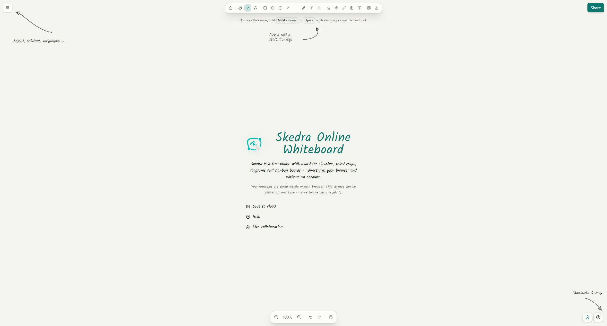

<p align="center"></p>

<h2 align="center">The open-source whiteboard for people and AI agents.</h2>

<p align="center">Self-hosted. Collaborative. Agent-editable. AGPL-3.0.</p>

<p align="center"><a href="https://skedra.xyz">Website</a> · <a href="https://skedra.xyz/docs/">Documentation</a> · <a href="SELFHOST.md">Self-host</a> · <a href="docs/MCP.md">MCP</a> · <a href="packages/react">React SDK</a> · <a href="https://discord.gg/7BqMSy5dy">Discord</a></p>

Skedra is an infinite canvas for sketches, diagrams, Kanban boards and Gantt timelines.
Work with your team in real time, or connect AI agents through the built-in MCP server.
Run the complete application on your own infrastructure. All features are available
without a Skedra subscription, license server or central Skedra account.

[skedra.xyz](https://skedra.xyz) provides documentation and project information.
The application, API, MCP server, library catalog, database, SDK and deployment
files live together in this repository. There is no separate commercial edition.



## Self-host Skedra

Run the all-in-one Docker image:

```bash
docker run -d \
  --name skedra \
  -p 3000:80 \
  -v skedra_data:/data \
  ghcr.io/moonriddim/skedra-community-standalone:latest
```

Open [http://localhost:3000](http://localhost:3000). PostgreSQL, files and instance
secrets persist in the `skedra_data` volume. The first registered user becomes the
instance administrator. Further registrations require an invitation by default.

See [SELFHOST.md](SELFHOST.md) for Docker Compose, production URLs, storage,
optional LiveKit calls, updates and backups. Images for this transition become
available after the changes are merged and the release workflow succeeds.

## Features

- Infinite canvas with text, shapes, arrows, drawing, images and frames.
- Native flowcharts, sequence diagrams, Kanban boards, Gantt charts and templates.
- Local browser boards and portable `.skedra` files.
- Accounts, teams, roles, permissions, comments, mentions and board activity.
- Real-time collaboration, encrypted storage and optional end-to-end encryption.
- Share links, presentations and read-only embeds.
- MCP server with 23 tools for structured, editable agent workflows.
- Shape libraries with `.skedralib` import and a self-hosted catalog.
- Optional AI with your own provider or local models, and optional LiveKit calls.
- Embeddable React SDK using the same canvas model, renderer and editor.

## MCP for AI agents

Connect Codex, Claude, Cursor or another client to your own instance:

```text
https://YOUR-SKEDRA-INSTANCE/api/mcp
```

Sign in to that instance through OAuth. API-key and local stdio configurations
are available in **Settings > API Keys & MCP**. There is no central hosted MCP
endpoint. See [docs/MCP.md](docs/MCP.md).

## Development

```bash
git clone https://github.com/moonriddim/skedra-community.git
cd skedra-community
corepack enable
docker compose -f docker-compose.dev.yml up -d
cp .env.example .env
pnpm install
pnpm db:push
pnpm dev
```

Open [http://localhost:5174](http://localhost:5174).
`pnpm dev` also watches the shared SDK. Use `pnpm sdk:verify` for focused SDK and
editor parity checks. `pnpm test` runs the workspace tests.

Build the independent static website with `pnpm docs:build` and preview it with
`pnpm docs:dev` at [http://localhost:5176](http://localhost:5176).
It requires no API, database, authentication or external service.

## Repository

- `apps/web`, `apps/api`, `apps/mcp`, `apps/libraries`: self-hosted application.
- `apps/docs`: static project website and documentation.
- `packages`: database, shared types, canvas core, editor, renderer, IO and React SDK.
- `deploy`: self-hosting, database migrations and reverse proxies.
- `.github/workflows`: checks and releases from this repository directly.

Contributions are welcome. Read [CONTRIBUTING.md](CONTRIBUTING.md), report bugs
in [GitHub Issues](https://github.com/moonriddim/skedra-community/issues), or join
[Discord](https://discord.gg/7BqMSy5dy).

## License

Skedra is licensed under [AGPL-3.0-only](LICENSE). You may use, modify, redistribute
and host it under that license, including commercially. Third-party material
retains its own terms. Your original boards and exports remain yours.
See [LICENSING.md](LICENSING.md) and the [transition guide](docs/OPEN-SOURCE-TRANSITION.md).
